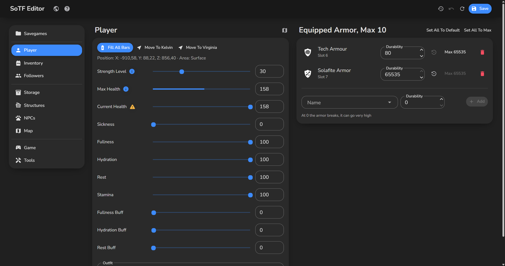
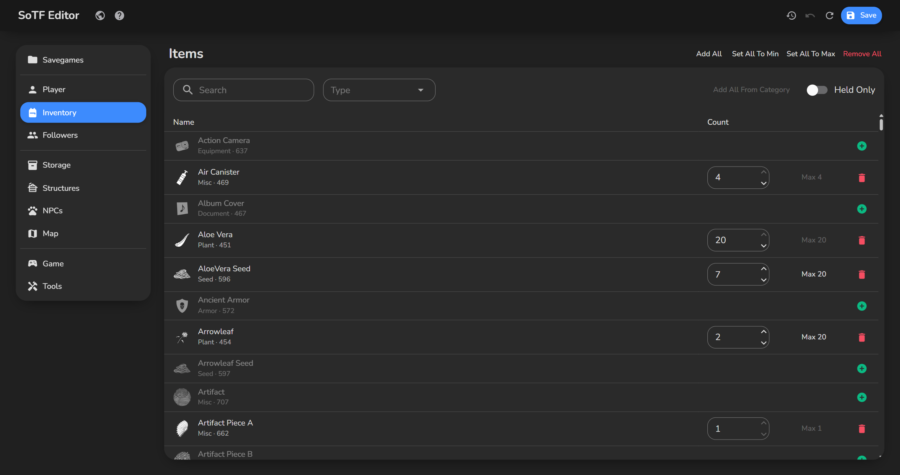
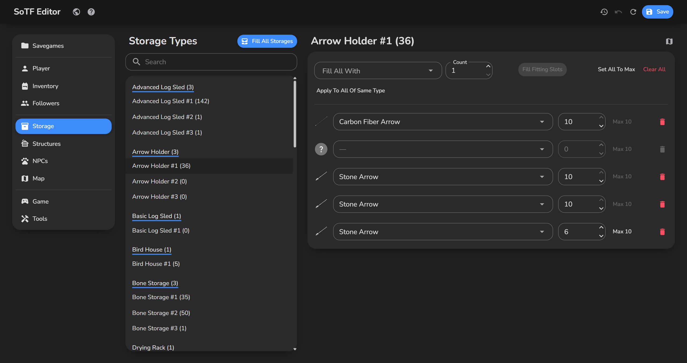
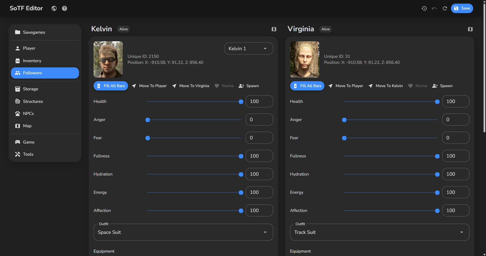
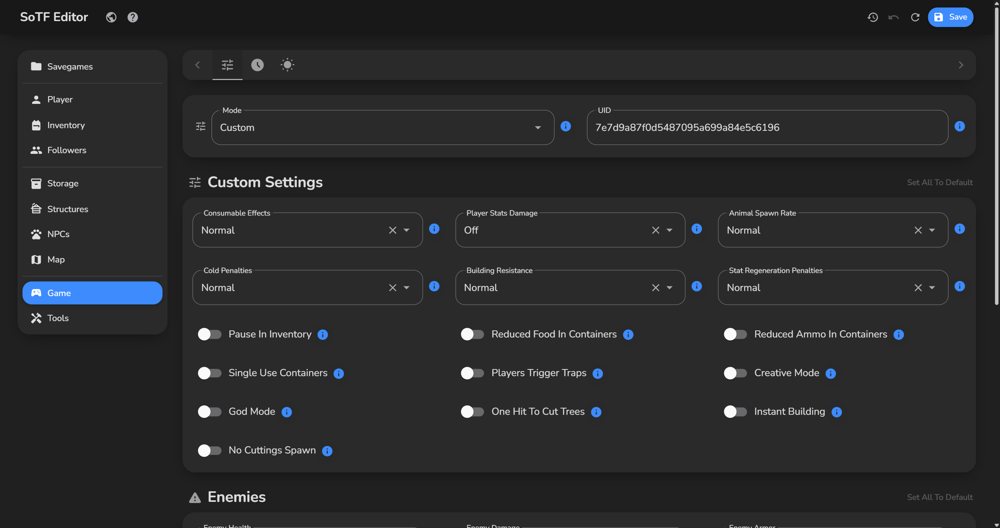
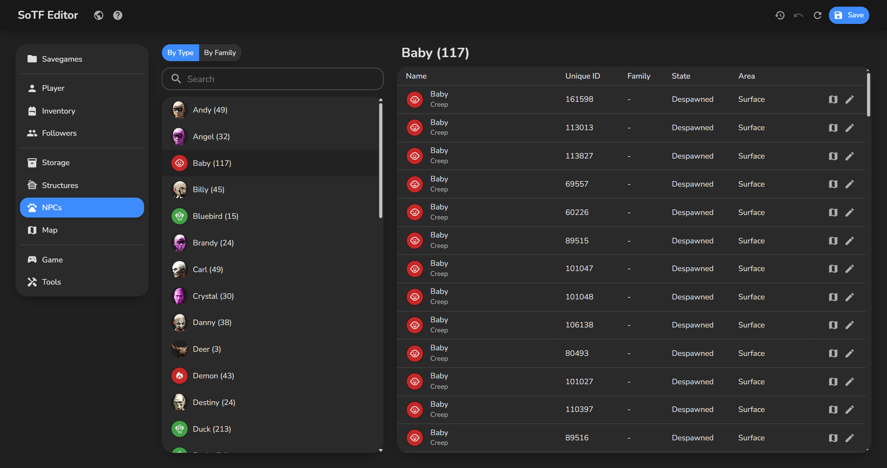
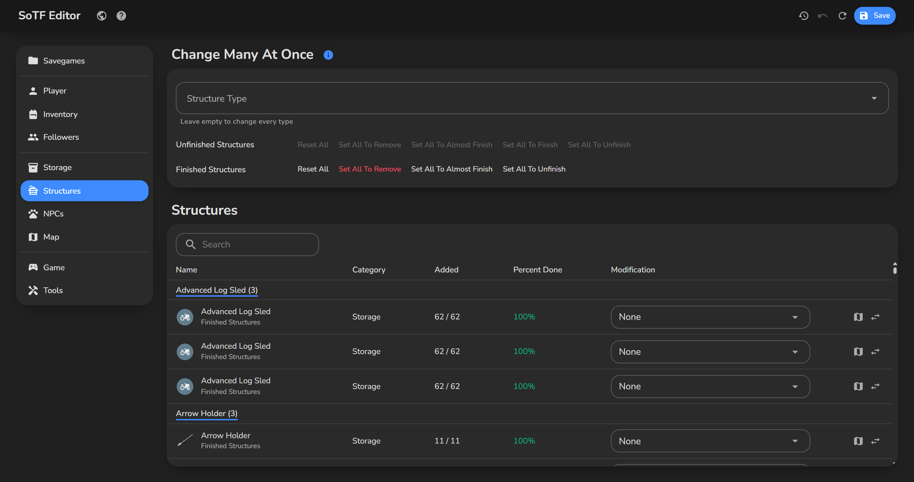
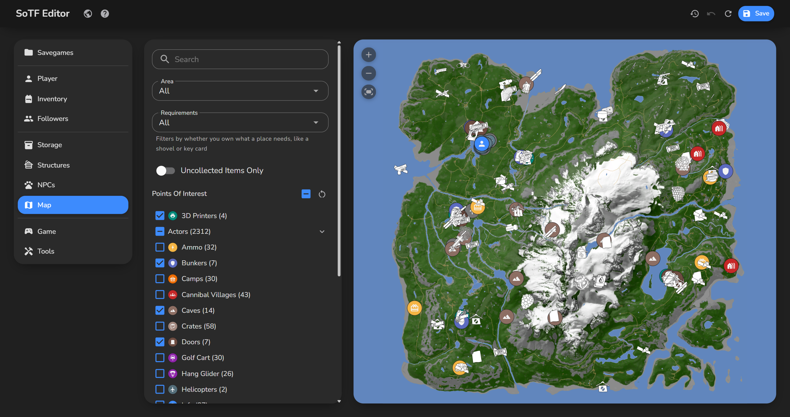
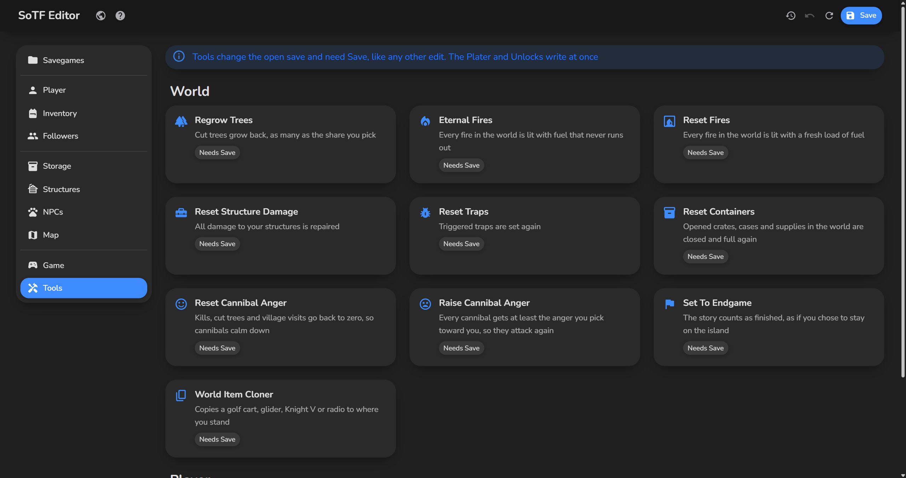
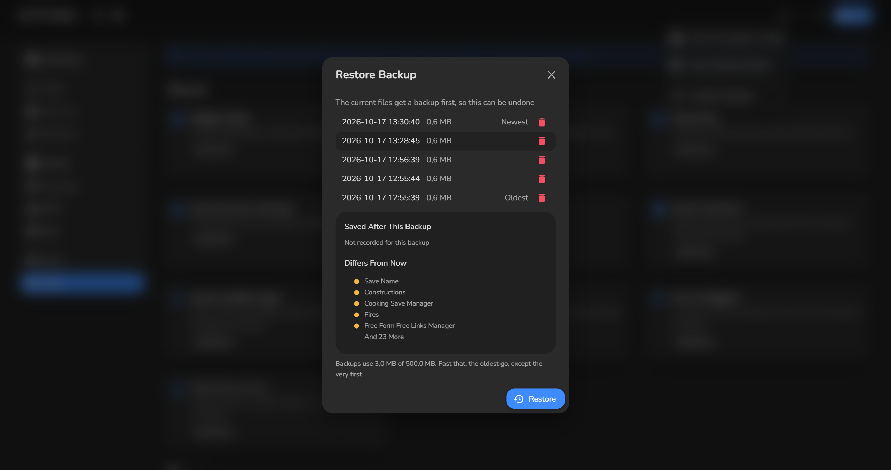

# SoTF Editor

<table>
  <tr><th width="33%">Inventory</th><th width="33%">Storage</th><th width="33%">Followers</th></tr>
  <tr><td></td><td></td><td></td></tr>
  <tr><th width="33%">Game</th><th width="33%">NPCs</th><th width="33%">Structures</th></tr>
  <tr><td></td><td></td><td></td></tr>
  <tr><th width="33%">Map</th><th width="33%">Tools</th><th width="33%">Backups</th></tr>
  <tr><td></td><td></td><td></td></tr>
</table>

## Features
- Player stats, outfit, armour and one inventory list of every item
- Every storage filled, maxed or cleared in one click
- Kelvin and Virginia, spawned copies too: stats, outfit, items, revive, spawn more or remove the extra ones
- Game setup, game state, season and weather, NPCs and structures, with info buttons that explain each setting
- Game presets such as Hard that you can still tweak setting by setting
- A small yellow dot on every value you changed and on its page in the menu, a list of every change before you save, and Revert Page to undo one page
- A map to teleport the player and followers, spawn actors or move ziplines, with a useful default selection you can reset to
- Savegame cards show the day, mode and crash site, and joined games also your strength and items
- Tools on their own page, such as regrow trees, reset fires, traps and containers, raise or reset cannibal anger, and item plating
- Updates itself in the background from inside the app, shows what changed and checks the download against GitHub's checksum
- Every list, card and map point works with the keyboard too
- English and Dutch

## Quick start
1. Download the exe from the [latest release](https://github.com/poolfullofmilk/SoTF.Editor/releases/latest)
2. Run it, there is nothing to install
3. Pick a savegame, edit, then Save

## ⚠️ Important
- Start the game and stay in the main menu while you edit, then load the save, so Steam Cloud cannot overwrite your changes
- Every save first copies the whole savegame to `Documents\SoTF.Editor\Backups`, and any backup can be restored or deleted from the app, which shows what that save changed and how the backup differs from now
- Past 500 MB of backups the oldest go, but every savegame keeps its first one
- If a backup or load fails, nothing is overwritten and the error has a button to the backup folder
- If the game saved while the editor was open, the editor warns before overwriting that progress
- A joined multiplayer save only holds your own player, the world lives in the host's save
- Windows may warn on the first run because the app is not signed: click More info, then Run anyway

## Technical details
- .NET 10, WPF, Blazor and MudBlazor, one self-contained exe
- Every release first passes a save round trip test on a sample savegame
- GPL-3.0, builds on SOTFEdit and map point data that are both MIT, see [THIRD-PARTY-NOTICES.txt](THIRD-PARTY-NOTICES.txt)
