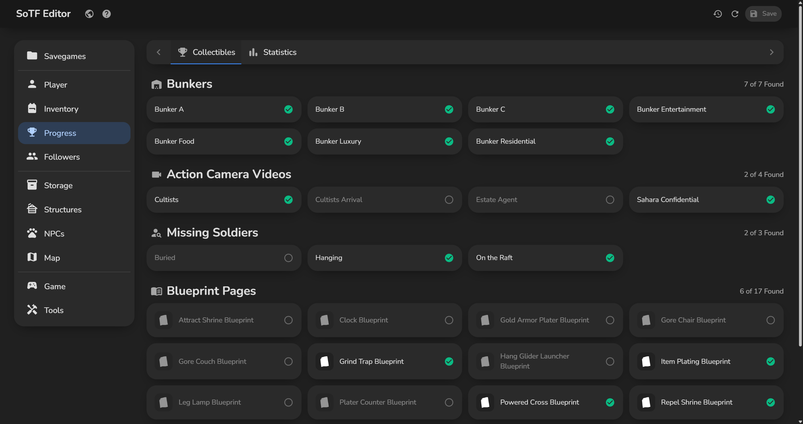

# SoTF Editor

## Features
- Edit your stats, armour, outfit and inventory
- Export your inventory to a small text file and import it into any save
- See which bunkers, videos, missing soldiers and blueprints you found, plus your kills and crafting
- Copy your player into another save, a friend's game you joined too
- Fill every storage to the max in one click
- Edit, revive or spawn Kelvin and Virginia
- Edit NPCs one at a time or all at once
- Change the game settings, the weather and the season
- Finish or remove structures
- Teleport yourself or anyone else on the map, and search or filter every point on it
- Teleport yourself in a friend's game too, from the save of a game you joined
- Tools such as regrowing trees, calming cannibals, ripening gardens and filling 3D printers
- Duplicate and export your savegames
- See every change before you save, and undo them page by page
- English, Dutch, German, French and Turkish, and it updates itself

## Quick start
1. Download the exe from the [latest release](https://github.com/poolfullofmilk/SoTF.Editor/releases/latest)
2. Run it, there is nothing to install
3. Pick a savegame, edit, then Save

## ⚠️ Important
- Start the game and stay in the main menu while you edit, then load the save, so Steam Cloud cannot overwrite your changes
- Every save makes a backup first, which you can restore from the app
- Windows may warn on the first run because the app is not signed: click More info, then Run anyway

## Technical details
- .NET 10, WPF, Blazor and MudBlazor, one self-contained exe
- GPL-3.0, builds on SOTFEdit and map point data that are both MIT, see [THIRD-PARTY-NOTICES.txt](THIRD-PARTY-NOTICES.txt)

## Screenshots

### Player

### Inventory

### Progress

### Storage

### Followers

### Game

### NPCs

### Structures

### Map

### Tools

### Backups

